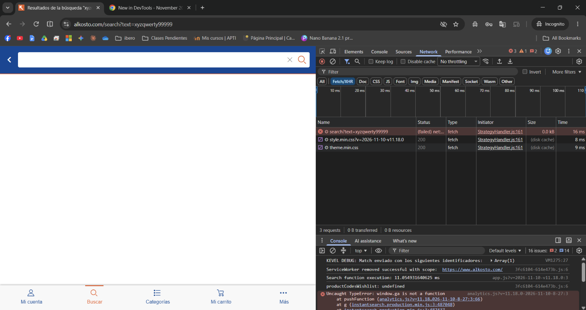

# 🐞 [BUG-002] Pantalla en blanco, petición fallida y error en consola (`window.ga`) al buscar término sin resultados

- **Proyecto / Módulo:** E-commerce Alkosto / Resultados de búsqueda
- **Caso de Prueba Relacionado:** [TC-ALK-002](../02-test-cases/alkosto-test-cases.md#tc-alk-002-búsqueda-con-término-inexistente)
- **Severidad:** Alta *(rompe la vista de resultados mostrando pantalla en blanco al usuario)*
- **Prioridad:** P1 (Inmediata)
- **Ambiente:**
  - **Navegador:** Google Chrome (Modo Incógnito)
  - **Sistema Operativo:** Windows
  - **URL:** `https://www.alkosto.com/search?text=xyzqwerty99999`

### 📋 Precondiciones
1. El usuario se encuentra en la página principal de Alkosto en modo incógnito.

### 👣 Pasos para reproducir
1. Hacer clic en la barra de búsqueda `"¿Qué buscas hoy?"`.
2. Ingresar una cadena sin coincidencias: `xyzqwerty99999`.
3. Presionar `Enter`.

### ❌ Resultado Actual
1. **UI:** La zona de resultados queda completamente en blanco (intermitente; al recargar sí llega a mostrar *"Lo sentimos, no encontramos ningún resultado"*).
2. **Network (`Fetch/XHR`):** La petición `search?text=xyzqwerty99999` falla con estado `(failed) net::...` (iniciada por `StrategyHandler.js:161`).
3. **Console:** Se registra un error JavaScript no controlado:
   ```text
   Uncaught TypeError: window.ga is not a function
       at pushFunction (analytics.js?v=11.18.0-2026-11-10-8-27:3:66)
       at g (instantsearch.production.min.js:3:487048)
   ```

### ✅ Resultado Esperado
El sistema debe validar la existencia de `window.ga` antes de invocarlo (`typeof window.ga === 'function'`) y mostrar siempre de forma consistente el mensaje *"Lo sentimos, no encontramos ningún resultado buscando por 'xyzqwerty99999'"* sin errores en consola ni pantalla en blanco.

### 📸 Evidencias

